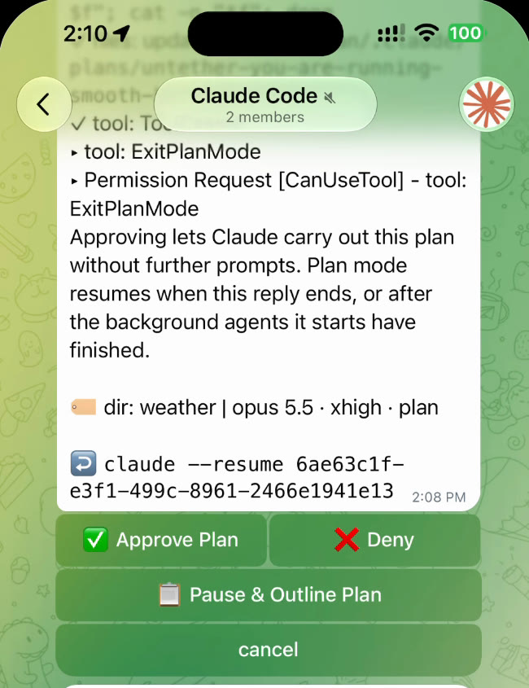
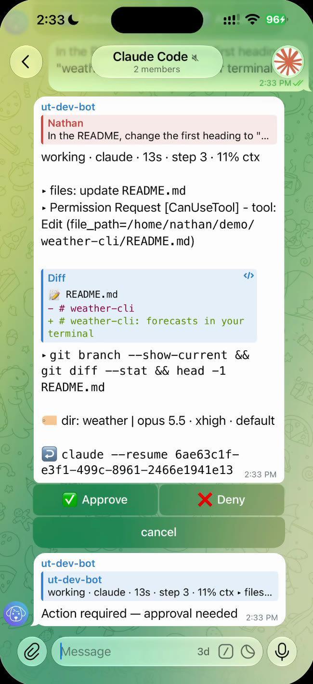
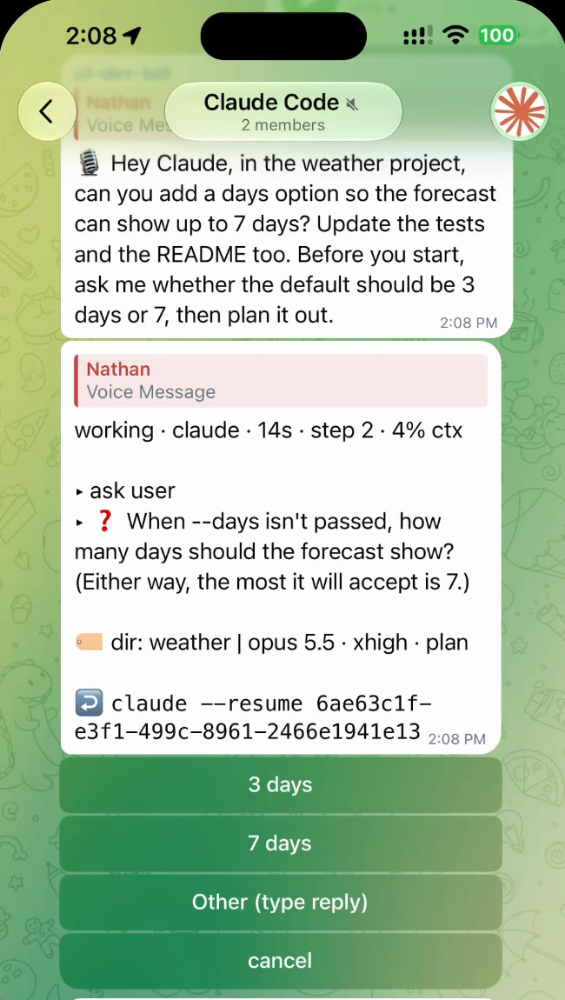

# Interactive approval

When Claude Code runs in permission mode, Untether shows inline buttons in Telegram so you can approve or deny tool calls from your phone.

## When buttons appear

What raises a button depends on the permission mode:

- **Plan mode** (`plan`) — when Claude Code wants to **exit plan mode** (ExitPlanMode) or **ask you a question** (AskUserQuestion). Every other tool request that reaches Untether is auto-approved by Untether.
- **`plan-auto`** — only questions. Untether approves the plan itself.
- **`auto`, `bypassPermissions`** — only questions; there is no plan step.
- **`dontAsk`** — nothing: only pre-approved tools run, and anything that would ask (questions included) is denied.
- **Accept edits** (`/planmode off`) and `default` / `manual` — any action the mode doesn't cover asks for approval, whatever the tool ([#749](https://github.com/littlebearapps/untether/issues/749)).

With **Diff preview** turned on in `/config`, Edit, Write and Bash requests in the autonomous modes also wait for a tap so you see the change first (except during the reply that follows a plan you approved).

A **background agent** can ask for approval after Claude has already replied — for example when a hook asks you to confirm one of its commands. That request arrives as its own message, with the same buttons, the agent's task and the reason it's asking. It's sent again after 10 minutes and then every 30 minutes while it waits (each copy replaces the last), and it's removed once you answer.

## The approval buttons

When a permission request arrives, you see a message with the tool name and a compact diff preview, plus buttons:

| Button | What it does |
|--------|-------------|
| **✅ Approve** | Let Claude Code proceed with the action (reads **✅ Approve Plan** on an ExitPlanMode request) |
| **❌ Deny** | Block the action and ask Claude Code to explain what it was about to do |
| **📋 Pause & Outline Plan** | Stop Claude Code and require a written plan before continuing (only appears for ExitPlanMode) |
| **💬 Let's discuss** | Talk about the plan before approving or denying (only appears after outline is written) |

Buttons clear immediately when you tap them — no waiting for a spinner.



<div markdown>

!!! untether "Untether"
    ▸ Permission Request [CanUseTool] - tool: Edit (file_path=src/main.py)

    ```diff
    📝 src/main.py
    - import sys
    + import sys
    + from pathlib import Path
    ```

<div class="tg-buttons">
<span class="tg-btn">✅ Approve</span>
<span class="tg-btn">❌ Deny</span>
</div>

</div>

## Diff previews

For tools that modify files, the approval message includes a compact diff, shown as a `diff` code block, so you can see what's about to change before deciding:

- **Edit**: 📝 file path, removed lines (`- old`) and added lines (`+ new`), up to 4 lines each
- **Write**: 📝 file path, then the first 8 lines of content to be written (as `+` lines)
- **Bash**: `$ command` (up to 200 characters)

Long lines are cut at 60 characters, and a `…(N more added)` line says how much was left out. Before v0.36.0 the preview was rendered as Markdown, so an added `+ x` line could show up as a `- x` bullet; it is now a fenced block that keeps every line as written ([#855](https://github.com/littlebearapps/untether/issues/855)).

This lets you make informed approve/deny decisions without leaving Telegram.

You can toggle diff previews on or off via `/config` → **Diff preview**. Approval messages include the diff unless you switch it off; when switched off they show the tool name and buttons only — no inline diffs. Switching it on also makes Edit, Write and Bash wait for a tap in the autonomous modes. Useful on slow connections or when you trust the agent enough to skim by tool name alone.

!!! untether "Untether"
    ▸ Permission Request [CanUseTool] - tool: Edit (file_path=src/main.py)

    ```diff
    📝 src/main.py
    - import sys
    + import sys
    + from pathlib import Path
    ```



!!! note "After plan approval"
    When you approve a plan outline (see [Plan mode](plan-mode.md#auto-approval-after-plan-approval)), diff previews are skipped for the rest of that reply — tools are auto-approved since you already reviewed the plan. Your next message gets diff previews again.

## Answering questions

When Claude Code calls `AskUserQuestion`, Untether renders the question with interactive option buttons in Telegram:

- **Option buttons** — one per row, up to four. Tap any option to answer instantly. Claude Code receives your choice and continues.
- **"Other (type reply)"** — tap this to type a custom answer. Send your reply as a regular message and Untether routes it back to Claude Code.
- **Multi-question flows** — if Claude Code asks multiple questions, they appear one at a time (e.g. "1 of 3"). Answer each to step through the sequence.

Toggle ask mode on or off via `/config` → Ask mode. When off, questions are auto-denied and Claude Code proceeds with defaults.

**Antigravity** asks through its own `ask_question` tool, and you get the same card: option buttons, **Other (type reply)**, or a text reply. This needs [Untether's agy plugin](antigravity.md#telegram-questions-and-steer) on the host; without it agy skips the question and carries on with its own default. agy shows your answer to the model and the progress row becomes `❓ answered: …`. If nobody answers within 15 minutes, agy is told to use its best judgement and say what it assumed (`⏱️ No answer — agy carried on`). Cron and webhook runs never show the card.



<div markdown>

!!! untether "Untether"
    ❓ Which test framework should I use?

<div class="tg-buttons">
<span class="tg-btn">pytest</span>
</div>
<div class="tg-buttons">
<span class="tg-btn">unittest</span>
</div>
<div class="tg-buttons">
<span class="tg-btn">Other (type reply)</span>
</div>

</div>

## Tapping a button twice, or too late

Each request can be answered once. A second tap (yours or someone else's in a group) doesn't send anything to Claude Code; you get a popup instead ([#685](https://github.com/littlebearapps/untether/issues/685), [#684](https://github.com/littlebearapps/untether/issues/684)):

- **Already answered** — plus a silent `ℹ️ Already answered — approved` (or `denied`, …) line saying what the first tap did
- **No longer needed** — Claude Code withdrew the request, for example because the turn ended; its buttons are removed
- **This request has expired** — the request timed out, or Untether no longer knows about it (for example after a restart)

Buttons only work in the chat they were posted in: a forged approval sent from another chat reads as expired and changes nothing ([#388](https://github.com/littlebearapps/untether/issues/388)).

An unanswered request is denied automatically after 5 minutes (`⏱️ Timed out: auto-denied after 5 min`). Untether checks for this when another approval request arrives, so a single request on its own waits for you.

## Who can answer in a group

In a chat with several allowed users, any of them can answer any request by default. Set `approval_originator_only = true` under `[transports.telegram]` to accept approvals and question answers only from the person whose message started the run; anyone else gets `Only the person who started this run can answer this.` Cron, webhook, `/at` and loop runs have no originator, so any allowed user can still answer them ([#388](https://github.com/littlebearapps/untether/issues/388)). See [Group chat](group-chat.md#only-the-person-who-started-the-run-can-approve-opt-in).

## Push notifications

When approval buttons appear, Untether sends a separate notification message so you don't miss it — even if your phone is locked or you're in another app.

## Ephemeral cleanup

Approval-related messages (notifications, button messages) are automatically deleted when the run finishes, keeping your chat clean.

## Auto-approve configuration

Which tools need approval depends on the permission mode. In plan mode only `ExitPlanMode` and `AskUserQuestion` reach you (in plan-auto and auto, only `AskUserQuestion`); every other request that reaches Untether is auto-approved by Untether, unless Diff preview is on. In Accept edits (and `default`/`manual` set in `untether.toml`), every tool Claude Code would prompt for becomes an Approve / Deny message. Allow rules in your Claude Code settings, or `[engines.claude] allowed_tools`, pre-approve tools in any mode.

To change this behaviour, adjust the permission mode. See [Plan mode](plan-mode.md) for details.

## Engine-specific approval policies

Claude Code is the only engine with interactive mid-run approval buttons. Other engines offer pre-run policies that control what the agent is allowed to do before it starts:

### Codex CLI — Approval policy

Toggle via `/config` → **Approval policy**:

| Policy | CLI flag | Behaviour |
|--------|----------|-----------|
| **Full auto** (default) | (none) | Codex uses your own Codex sandbox setting (`sandbox_mode` in `~/.codex/config.toml`, or the project's trust level). For a trusted project that is usually `workspace-write`, so Codex can edit files there |
| **Safe** | `codex exec --sandbox read-only` | Reads and read-only commands only. Edits and writes fail and are reported back to the model; shell network access is blocked |

This is a pre-run policy — Codex doesn't pause mid-run to ask for permission. `codex exec` never asks for approval, so the policy picks Codex's sandbox before the run starts.

!!! warning "Safe blocks every sandboxed write"
    The read-only sandbox blocks **all** filesystem writes from Codex's commands, not just edits inside the project: caches (`.pytest_cache`, `__pycache__`, `npm`/`uv` caches), build output and `/tmp` too. Tests, builds and package installs fail in Safe. Switch the chat to **Full auto** when you want Codex to run them. MCP tools run outside Codex's command sandbox, so Safe does not restrict what an MCP server does.

!!! note "Before v0.36.0"
    Safe used to pass `--ask-for-approval untrusted`. `codex exec` never applied that flag, so Safe ran exactly like Full auto, and codex-cli 0.149.0+ rejects it outright, so every Safe run failed at startup ([#830](https://github.com/littlebearapps/untether/issues/830)).

### Antigravity CLI — Permission mode

Toggle via `/config` → **Permission mode**:

| Mode | CLI flag | Behaviour |
|------|----------|-----------|
| **Workspace** (default) | `--mode=accept-edits` `--agent=untether-workspace` | Antigravity reads, creates and edits files in the project. It has no shell, web, MCP or subagent tools, so it can't run commands, and can't delete or rename files. Not a sandbox — see below |
| **Ask me** | `--dangerously-skip-permissions`, once Untether's agy plugin is ready for the project | Reads and in-project edits run on their own; shell commands, web, MCP, browser, subagents, timers, files outside the project and protected files get **✅ Approve / ❌ Deny** buttons with the command or a diff. See [Ask me](#antigravity-ask-me) below |
| **Plan first** | `--mode=plan` `--agent=untether-workspace` | Antigravity reads the project and writes a plan, changing nothing. The plan is posted with **✅ Approve Plan / ❌ Deny / 💬 Let's discuss**; Approve carries it out in Workspace mode. See [Plan first](#antigravity-plan-first) below |
| **Full access** | `--dangerously-skip-permissions` | Every tool is approved, including shell, network and files outside the project. Takes effect from the next new conversation — send `/new` after switching |

Workspace, Plan first and Full access are pre-run policies: headless agy can't stop mid-run to ask by itself. **Ask me** adds per-tool Approve / Deny buttons through [Untether's agy plugin](antigravity.md#telegram-questions-and-steer) (which also gives questions asked with `ask_question` their buttons). Without the plugin `/config` shows **🔒 Ask me — set up**, and a run set to Ask me (for example from `untether.toml`) is refused before it starts rather than run as something else. **Plan first** agy plans and stops, and you answer the plan afterwards. In an Antigravity chat `/planmode on` picks Plan first and `/planmode off` goes back to Workspace.

!!! warning "After switching between Workspace / Plan first and Ask me / Full access, send `/new`"
    agy keeps a conversation on the tools it started with. A conversation that began in Workspace or Plan first keeps its no-shell tools after you switch the chat to **Full access** or **Ask me**, even though the footer says `full access` / `ask me` — in Ask me it then has no shell to ask you about. Send `/new`: the new mode applies from the next new conversation. The `/config` toast says the same (`Permission mode: ask me — send /new if you're switching from Workspace or Plan first`).

    Switching Full access or Ask me → Workspace needs `/new` too. A conversation that began on agy's default tools keeps them, so a shell attempt there is blocked and the turn ends on the ⚠️ notice, which then says to send `/new` (or pick Full access again). The same goes for → Plan first. The toasts say `Permission mode: workspace — send /new if you're switching from Full access or Ask me` (and the same for plan first); moving between Workspace and Plan first, or between Ask me and Full access, needs no `/new` ([#1060](https://github.com/littlebearapps/untether/issues/1060), [#980](https://github.com/littlebearapps/untether/issues/980)).

#### Antigravity: Ask me

**Ask me** ([#980](https://github.com/littlebearapps/untether/issues/980)) is the closest Antigravity gets to Claude Code's approval buttons. It needs [Untether's agy plugin](antigravity.md#telegram-questions-and-steer) on the host: agy runs with all its tools (`--dangerously-skip-permissions`, its default agent), and the plugin holds every tool call until Untether answers. Untether never passes that flag for Ask me unless the plugin is installed, unedited and loaded by agy for the project.

- **Runs without a card:** reading, listing and searching files inside the project, and creating or editing files there (plus agy's own notes for the conversation).
- **Asks first:** reading files outside the project, shell commands, web fetches and searches, MCP tools, browser actions, subagents and timers; files outside the project; protected files in it (`.agents/`, `.git/`, `.gemini/`, `.claude/`, `.github/workflows/`, `.husky/`, `.untether-outbox/`, `.mcp.json`, `.envrc`, `.vscode/tasks.json`, `.pre-commit-config.yaml`, `CLAUDE.md`, `AGENTS.md`, `GEMINI.md`, `.env` files and keys); Untether's own files; and any tool Untether doesn't know yet. With **Diff preview** on, in-project edits ask too. A path that goes through a symlink, or a file with a second hard-linked name, always asks (the card says where it really resolves): approving a shell command can create links that change what a later "in-project" path means.

The card reads like Claude's:

!!! untether "Untether"
    ⚠️ Permission Request [agy] - shell command
    $ `npm test`
    in packages/api · moves to the background after 5 s if still running
    agy says: Run the test suite

    [✅ Approve] [❌ Deny]
    [✅ Always allow this command here]

An edit shows the file and the lines added and removed (`📝 src/app.py`, `-` / `+`); a write or read outside the project says `(outside this project)`; a command that starts a daemon warns that it keeps running after the turn; a subagent's call says `from subagent: <role>`. agy's own description comes last and is only agy's words — the lines above it are what will actually run.

- **✅ Approve** runs the tool. **✅ Always allow this command here** (shell commands only) also lets the exact same command, in the same folder, run without asking for the rest of the conversation; it is forgotten on `/new`, a switch to another mode or a restart.
- **❌ Deny** blocks it: agy is told you refused and not to retry, and the step reads `blocked: denied in Telegram`.
- **No answer** within 15 minutes (or `[antigravity] approval_timeout_s`) blocks it too, and the card reads `⏱️ Timed out: denied after 15 min`.

Reminders, push notifications and [who can answer](#who-can-answer-in-a-group) work as for Claude Code. Cron runs get Ask me only from their own `permission_mode = "ask"`; with nobody to tap, everything that would ask is denied at once and the answer ends with a `🔒 unattended` footer. A chat's Ask me runs scheduled runs as Workspace.

Ask me is refused (nothing runs) when the plugin isn't ready for the project, when the project contains Untether's own code, or when agy loads hooks, plugins, agents or MCP servers there that Untether doesn't manage — those run commands without asking. The reply says which and what to do; see [Troubleshooting](troubleshooting.md#antigravity-ask-me-is-refused).

#### Antigravity: Plan first

Pick **Plan first** in `/config` → **Permission mode** (or send `/planmode on`), then ask for a change as usual:

1. Antigravity looks around the project and writes a plan. Nothing in the project changes; agy itself blocks
   project edits in a plan run.
2. The answer shows the plan (`📋 Plan — implementation_plan.md` and the plan text), then a card with three
   buttons:
    - **✅ Approve Plan** — Antigravity carries out the plan in Workspace mode: it edits files in the project, with
      no shell. A new run starts in the same conversation; its footer says `workspace · plan approved` and its
      answer starts `📋 Plan (approved)`.
    - **❌ Deny** — nothing runs. Send a message to keep planning, or `/new` to start over.
    - **💬 Let's discuss** — nothing runs. Reply with what to change; Antigravity rewrites the plan and posts a new
      card.
3. The chat stays in Plan first, so your next request is planned again first. Switch back with `/planmode off` or
   `/config`.

Good to know:

- Only the newest card for a conversation can be approved, and a card can be answered once. When a newer plan
  replaces a card, the old card loses its buttons and says `Replaced by a newer plan — use the latest card.` Cards
  expire after 24 hours or when Untether restarts; tapping an expired card takes its buttons off. Send a message to
  get a fresh plan.
- If Antigravity answers without writing a plan, there is nothing to approve: the answer ends with a note saying
  so. Reply to keep planning.
- If Antigravity tries to change a file while planning (copying the plan into the project, say), agy blocks it:
  the step shows `⚠️ Blocked: file change` and the answer ends `Plan first doesn't change files until you approve
  the plan.` A file outside the project is blocked as in Workspace.
- Cron and webhook runs in Plan first post the plan and change nothing — nobody is there to approve it. The footer
  says `🔒 unattended … denied plan approval`. Give the cron `permission_mode = "workspace"` if it should make the
  change.
- After switching from **Full access** to Plan first, send `/new`: a conversation that started in Full access keeps
  its shell-capable tools.
- Plan first can't approve into Full access: the approved run is always Workspace.

**What Workspace can and can't do.** Workspace runs use a no-shell agent that Untether manages ([#1037](https://github.com/littlebearapps/untether/issues/1037)). Its tool list is file tools only: view, list, find, grep, write and replace. So:

- Ask for a shell command (tests, `git`, a build) and the command doesn't run. Antigravity answers in plain words that this needs Full access; there is no ⚠️ blocked notice.
- It can't delete or rename files. A "rename" is a copy: the new file is written and the original stays.
- Web fetches, MCP tools and subagents aren't available either.
- Reads and writes outside the project are still blocked by agy, with the notice below.

**The managed agent file.** Untether writes `~/.gemini/config/agents/untether-workspace/agent.md` (agy's user-level custom-agent folder) and passes `--agent=untether-workspace` on Workspace runs. Untether rewrites the file if it is changed, so don't edit it. It does nothing for your own interactive `agy` unless you pick that agent there. If Untether can't write the file, the path is a symlink, or the project defines agy agents or plugins of its own (under `.agents/`), the run goes ahead without the agent and the log has a `antigravity.workspace_agent.unavailable` warning; see [Troubleshooting](troubleshooting.md#antigravity-workspace-agent-file-unavailable). Full access never passes `--agent`.

**When agy blocks a tool.** A read or write outside the project isn't carried out. The progress message shows a ⚠️ Blocked row, the turn stops there, and the final reply ends with how to allow it:

!!! untether "Untether"
    ⚠️ Antigravity was blocked from using a file outside the project — headless runs can't ask for approval, so it stopped there. To allow it: /config → Permission mode → Full access, then /new.

A blocked shell command (a row such as `⚠️ Blocked: shell command (RunCommand) — npm test`) can still happen in a conversation that isn't on the no-shell agent: one started in Full access, or when the agent file is unavailable. Its notice names the shell command and adds an allow-rule hint: "…Full access, then /new, or add an allow rule such as `command(git status)` to agy's settings file." When the conversation started in Full access and the chat is now on Workspace, the notice says that instead: "This conversation started without Workspace's no-shell tools (in Full access, for example), and agy keeps the tools a conversation started with, so it still tried the shell. Send /new to start a Workspace conversation, or pick Full access in /config to let it run."

**Allow rules.** Exact rules in `permissions.allow` in agy's own settings file (`~/.gemini/antigravity-cli/settings.json`), for example `command(git status)`, only matter where agy has a shell tool to block, which is the cases in the paragraph above. A Workspace conversation on the no-shell agent has no shell tool, so an allow rule doesn't give it one; use Full access. Exact commands are the reliable form; prefix patterns don't match consistently in headless runs. When agy's settings carry allow rules, or let it reach files outside the project, Untether shows a ⚠️ row saying so.

**Defaults and scheduled runs.** Set a default with `permission_mode = "full"` (or `"workspace"`, `"ask"` or `"plan"`) under `[antigravity]` in `untether.toml`. Unknown values are rejected at startup, and an unknown stored value runs as Workspace. Cron and webhook runs never inherit Full access or Ask me from the chat or `untether.toml`: a cron gets either only from its own `permission_mode`, and webhook runs never get Full access.

**agy's own settings can override the mode.** If agy's settings file sets `toolPermission` to anything other than `request-review` or `strict` (for example `always-proceed`), agy would approve tools by itself, so Untether refuses to run Workspace and tells you to set it back or pick Full access.

!!! warning "Workspace is not a sandbox"
    Workspace only limits agy's own tool calls. agy hooks, plugins, custom agents and `.agents/mcp_config.json` MCP servers run their own commands in every mode, and a run can write those files for the next run to execute. Untether shows a ⚠️ row when a project carries agy config it doesn't manage, and when a run changes it or another engine's files (such as `.claude/`, `.envrc` or `.github/workflows/`). After agy's config changes, or when Untether can't check it, cron and webhook runs in that project are held until someone sends a message in the chat. This is a warning system with [known limits](../reference/runners/antigravity/runner.md#agy-hooks-plugins-and-mcp-servers), not isolation. Only run Antigravity in projects you trust.

Before you use a Google account sign-in with Antigravity, read the [terms note](switch-engines.md#antigravity-cli). For the rest of the engine (first run, effort, quota, scheduled runs), see [Use Antigravity CLI](antigravity.md).

### Gemini CLI — Approval mode

!!! warning "Deprecated"
    Gemini CLI is deprecated in Untether and no longer supported: it is still included, but gets no fixes and may be removed in a future release. See [Switch engines](switch-engines.md).

Toggle via `/config` → **Approval mode**:

| Mode | CLI flag | Behaviour |
|------|----------|-----------|
| **Read-only** (shown when no mode is set) | `--approval-mode yolo` | **Not actually read-only** — see the warning below |
| **Edit files** | `--approval-mode auto_edit` | File reads and writes OK, shell commands blocked |
| **Full access** | `--approval-mode yolo` | All tools approved — full autonomy |

This is also a pre-run policy. Gemini CLI doesn't have interactive mid-run approval.

!!! warning "Read-only runs with full access"
    With no approval mode set, Untether starts Gemini CLI with `--approval-mode yolo`, so every tool is approved. The **Read-only** button in `/config` only clears the chat's setting, which lands back on that same default; it does not restrict Gemini. Use **Edit files** if you need shell commands blocked. The Gemini engine is deprecated and no longer receives fixes, so it won't get a read-only mode.

Both policies persist per chat via `/config` and can be cleared back to the default. See [Inline settings](inline-settings.md) for the full `/config` menu reference.

## Related

- [Plan mode](plan-mode.md) — control when and how approval requests appear
- [Inline settings](inline-settings.md) — `/config` menu for toggling approval policies
- [Use Antigravity CLI](antigravity.md) — Antigravity setup, permission modes and limits
- [Commands & directives](../reference/commands-and-directives.md) — full command reference
- [Claude Code runner](../reference/runners/claude/runner.md) — technical details of the control channel
